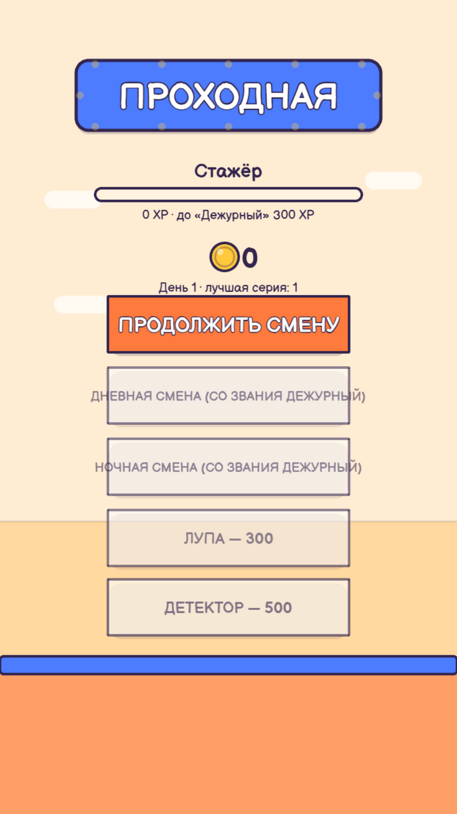

# Проходная



Моя первая законченная игра — казуальный «инспектор-сим» для платформы
[Яндекс Игры](https://yandex.ru/games). Ты дежурный на проходной: перед тобой очередь
существ с пропусками, на доске — правила дня. Сверяешь признаки гостя с документом
и правилами: своих пропускаешь, самозванцев разворачиваешь.


Идея родилась из простого наблюдения: механика «найди отличие» десятилетиями держит
ретеншн в казуальных играх, а жанр «инспектор документов» (Papers, Please) доказал виральность,
но в веб-казуале его почти нет. Я обернул сверку документов в доброжелательных персонажей,
которые генерируются кодом из простых фигур, и добавил дневной цикл с общим для всех игроков
сидом — сервер не нужен, а соревнование есть.

## Что игра умеет

- **25 правил-запретов** в пяти тирах сложности: от «не пускать синие головы» до
  «оранжевые тела с антеннами не пускать». Активный набор растёт со сменами и ротируется,
  конфликтующие правила никогда не активируются вместе.
- **Три типа самозванцев** с ровно одной причиной отказа: подделка пропуска, нарушитель
  правила дня, дефектный документ (просрочка / нет подписи). Каждая ошибка объясняется карточкой.
- **Процедурная смена по сиду**: mulberry32 с суб-потоками, инварианты генерации покрыты
  unit-тестами на сотнях сидов. Рестарт смены — новый сид, заучивание очереди исключено.
- **Экономика и мета**: жетоны, XP, пять званий, инструменты Лупа и Детектор.
- **Дневная смена** с общим для всех сидом (hash от даты — сервер не нужен) и **ночная смена ×1.5**.
- **Монетизация по правилам платформы**: 4 rewarded-точки (прощение ошибки, заряд детектора,
  ×2 жетоны, ночная смена) — прогресс никогда не блокируется без рекламы.
- **Облачные сейвы и лидерборды** (лучшая серия, дневной скор) через Яндекс SDK.
- **Весь арт рисуется кодом**: Phaser Graphics, ноль растровых ассетов. Звук — синтез WebAudio.
  Zip для загрузки в Яндекс: ~450 КБ.

## Как запустить

```bash
npm install
npm run dev      # http://localhost:5173 — локально играется без интернета
npm run test     # Vitest: генерация, инварианты, экономика, сейв
npm run lint
npm run dist     # сборка + zip для черновика в Консоли Яндекса
```

## Как устроено

- `src/platform` — единый интерфейс `PlatformAPI`: `LocalPlatform` (localStorage + мок рекламы)
  и `YandexPlatform` (реальный SDK). Игра не знает, где запущена.
- `src/game` — чистая логика без Phaser: правила, генерация, экономика, сейв. Покрыта Vitest.
- `src/render` — booth-сцена, персонажи из Graphics-примитивов, пропуск, доска правил, juice.
- `src/scenes` — кабинет, смена, тест платформы.

## Стек

TypeScript (strict), Phaser 3, Vite, Vitest, ESLint/Prettier.

## Что дальше

Kill-гейт с живыми тестировщиками по протоколу из ГДД, interstitial по политике платформы,
иконка и обложка для каталога, EN-локализация.
