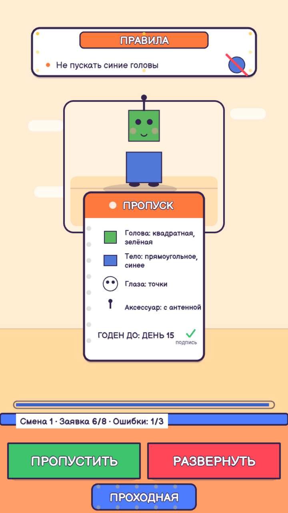

# Проходная

**Играть в браузере:** [kerarty.github.io/prohodnaya](https://kerarty.github.io/prohodnaya/)


Моя первая законченная игра — казуальный «инспектор-сим». Ты дежурный на проходной:
перед тобой очередь существ с пропусками, на доске — правила дня. Сверяешь признаки гостя
с документом и правилами: своих пропускаешь, самозванцев разворачиваешь. Одна сборка
работает на [Яндекс Играх](https://yandex.ru/games), [CrazyGames](https://www.crazygames.com/)
и [itch.io](https://itch.io).



Идея родилась из простого наблюдения: механика «найди отличие» десятилетиями держит
ретеншн в казуальных играх, а жанр «инспектор документов» (Papers, Please) доказал виральность,
но в веб-казуале его почти нет. Я обернул сверку документов в доброжелательных персонажей,
которые генерируются кодом из простых фигур, и добавил соревновательные режимы с общим
сидом — сервер для геймплея не нужен.

## Что игра умеет

- **25 правил-запретов** в пяти тирах сложности: от «не пускать синие головы» до
  «оранжевые тела с антеннами не пускать». Активный набор растёт со сменами и ротируется,
  конфликтующие правила никогда не активируются вместе.
- **Три типа самозванцев** с ровно одной причиной отказа: подделка пропуска, нарушитель
  правила дня, дефектный документ (просрочка / нет подписи). Каждая ошибка объясняется
  карточкой; ошибки на обучающих заявках прощаются.
- **Процедурная смена по сиду**: mulberry32 с суб-потоками, инварианты генерации покрыты
  unit-тестами на сотнях сидов. Рестарт смены — новый сид, заучивание очереди исключено.
- **Экономика и мета**: жетоны, XP, пять званий, инструменты Лупа и Детектор,
  **дневная смена** с общим для всех сидом (hash от даты — сервер не нужен) и
  **ночная смена ×1.5**.
- **Блиц на 90 секунд** с личным рейтингом, который самокалибруется к уровню игрока.
- **Дуэли в реальном времени через WebRTC (P2P, без игрового сервера)**: быстрый матч,
  комнаты по коду и приглашения по ссылке. Общий сид и общий старт — оба игрока проходят
  одну и ту же очередь. Есть соперник-бот, так что дуэль всегда играется, даже офлайн.
- **Топ-50** по рейтингам блица и дуэлей: таблицу держит лёгкий сигналинг-сервер,
  своя строка подсвечена и видна всегда.
- **7 языков** (ru, en, es, pt, fr, de, it) с выбором в игре и автоопределением на платформах.
- **Адаптация под любой экран**: колонка интерфейса 720×1280 масштабируется под окно,
  фон-офис тянется на весь экран, на телефонах низ интерфейса прижат к нижнему краю
  (не мешает вырезу). Живой ресайз и поворот — без рестарта сцены.
- **Монетизация по правилам платформ**: rewarded-точки (прощение ошибки, заряд детектора,
  ×2 жетоны, ночная смена) и midgame-паузы — прогресс никогда не блокируется без рекламы.
  На itch.io рекламные точки скрываются.
- **Облачные сейвы** (Яндекс SDK / CrazyGames Data Module) с локальным фолбэком:
  прогресс не теряется ни у авторизованных, ни у гостей.
- **Весь арт рисуется кодом**: Phaser Graphics, ноль растровых ассетов. Звук — синтез
  WebAudio. Zip для загрузки в платформы: ~440 КБ.

## Как запустить

```bash
npm install
npm run dev        # http://localhost:5173 — локально играется без интернета
npm run test       # Vitest (78 тестов): генерация, инварианты, экономика, сейв, сеть
npm run lint
npm run dist       # сборка + zip для черновика в Консоли Яндекса / CrazyGames
npm run dist:itch  # сборка + zip для itch.io (без рекламных точек)
```

Локальные дуэли между двумя вкладками:

```bash
node server/p2p-signal.mjs --port 9100   # сигналинг + сервер топ-50
npm run dev                              # затем открыть дважды:
# вкладка 1: http://localhost:5173/?peer=localhost:9100  → ДУЭЛЬ → создать комнату
# вкладка 2: тот же адрес + ?duel=КОД (или войти по коду в лобби)
```

Полезные параметры запуска: `?debug` (сцена теста платформы), `?canvas=1`
(Canvas-рендерер вместо WebGL), `?lang=en` (`ru/es/pt/fr/de/it`), `?platform=crazy`
(SDK CrazyGames в local-режиме), `?server=URL` (HTTP-сервер дуэлей `server/index.mjs`),
`?peer=host:port` (свой сигналинг/топ-50), `?duel=КОД` (вход по приглашению).

## Как устроено

- `src/platform` — единый интерфейс `PlatformAPI`, игра не знает, где запущена:
  `YandexPlatform` (SDK Яндекса: ready/gameplay, облачные сейвы, реклама, лидерборды),
  `CrazyPlatform` (SDK v3: loading/gameplay/happytime, rewarded+midgame, Data Module,
  invite-ссылки), `ItchPlatform` (без рекламных точек), `LocalPlatform` (мок для дева).
- `src/game` — чистая логика без Phaser: правила, генерация, экономика, рейтинги, сейв.
  Покрыта Vitest.
- `src/net` — сетевой слой дуэлей: `P2PMatchAPI` (WebRTC через peerjs, детерминированные
  peer-id для комнат и хабов матчмейкинга), `HttpMatchAPI` (опциональный свой сервер),
  `LocalMatchAPI` (бот-соперник), клиент топ-50.
- `src/render` — booth-сцена, персонажи из Graphics-примитивов, пропуск, доска правил,
  juice, модуль адаптивного вьюпорта (`layout.ts`).
- `src/i18n` — 7 локалей: канон в `en.ts`, полнота остальных проверяется TypeScript'ом.
- `src/scenes` — кабинет, смена (обычная/дневная/ночная/блиц/дуэль), тест платформы.
- `server/` — `p2p-signal.mjs` (сигналинг PeerJS 1.5 + хранилище топ-50) и
  `index.mjs` (опциональный HTTP-сервер дуэлей с Elo).

## Стек

TypeScript (strict), Phaser 3, PeerJS (WebRTC), Vite, Vitest, ESLint/Prettier, ws.

## Что дальше

Kill-гейт с живыми тестировщиками по протоколу из ГДД, иконка и обложка для каталогов,
проверка черновиков на мобильных платформах, хостинг сигналинга для глобального топ-50.
